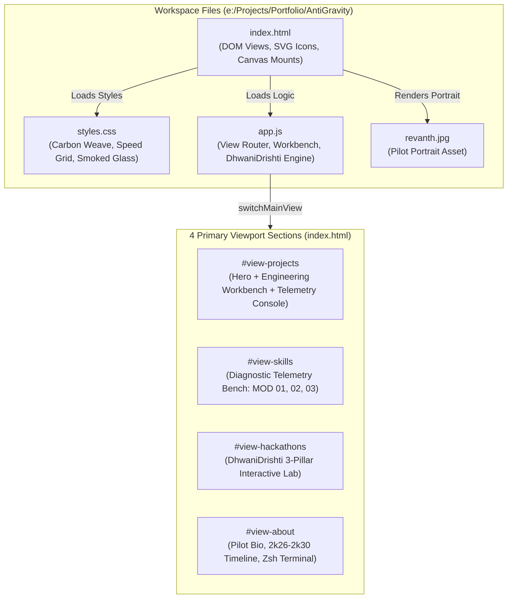
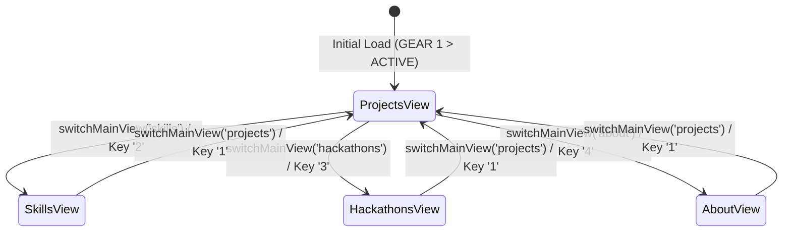
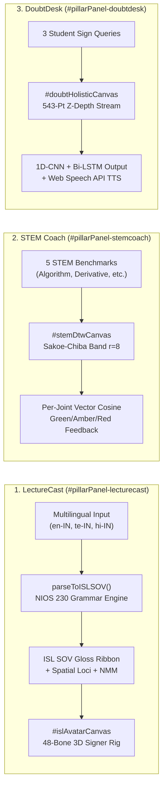

# Master Architecture & System Blueprint — Bandaru Revanth Portfolio Website

This document serves as the master architectural reference for the **Bandaru Revanth F1 Telemetry Engineering Portfolio** (`e:\Projects\Portfolio\AntiGravity`). It explains the file structure, visual design tokens, single-page view routing, interactive telemetry consoles, and the embedded **DhwaniDrishti** engine.

---

## 1. High-Level System Overview

The project is architected as a **zero-build, standalone static website** powered by semantic HTML5, custom CSS3 telemetry shaders, Tailwind CSS utility configuration, and vanilla ES6+ JavaScript. It requires no Node.js bundler or runtime server to execute—opening `index.html` directly in any modern browser initializes the entire interactive suite.

---

## 2. File Inventory & Responsibilities

| File | Purpose & Key Contents |
| :--- | :--- |
| **`index.html`** | Master document containing the Tailwind theme configuration (`charcoal`, `gunmetal`, `titanium`, `f1red`, `amberGlow`), Top Navigation Header, 4 main view sections (`#view-projects`, `#view-skills`, `#view-hackathons`, `#view-about`), Telemetry Footer, and Contact Modal (`#contactModal`). |
| **`styles.css`** | Custom F1 Pit-Lane aesthetic rules: `.carbon-bg` (diagonal carbon-fiber weave), `.speed-grid` (animated 6s perspective grid), `.smoked-glass` / `.smoked-card` (backdrop-blurred titanium panels with crimson hover borders), `.nav-btn` (cubic-bezier underline snap), and `.view-section` / `.tab-panel` transitions. |
| **`app.js`** | All client-side state, view navigation, workbench tab cycling, terminal command emulation, contact packet mailto dispatch, and the full interactive **DhwaniDrishti** 3-pillar simulation engine (`LectureCast`, `ISL-STEM Coach`, `DoubtDesk`). |
| **`revanth.jpg`** | Local portrait image rendered in the Top Navigation logo, About page header, Engineering Philosophy portrait card, and Contact Modal header. |

---

## 3. Design System & Aesthetic Tokens

### 3.1 Color Palette (Tailwind Config in `index.html`)
- **`charcoal` (`#121316`)**: Primary deep background canvas.
- **`gunmetal` (`#1C1E24`)**: Secondary surface elevation.
- **`titanium` (`#2A2D35`)**: Card border and button surface tone.
- **`f1red` (`#E60000`) & `f1redBright` (`#FF1A1A`)**: Primary Formula 1 crimson accent for active indicators, tachometers, and primary CTAs.
- **`amberGlow` (`#FF9900`)**: Secondary telemetry accent used for Hackathon deployments, LeetCode badges, and STEM Coach metrics.
- **`#10B981` (Emerald)**: Used for online status indicators, CodeChef badges, and DoubtDesk 30+ FPS WASM status readouts.

### 3.2 Typography
- **Display / Headers (`font-rajdhani`)**: *Rajdhani* (600/700 uppercase) for high-contrast motorsport telemetry titles.
- **Body Copy (`font-sans`)**: *Inter* (300–600) for clean readability in project descriptions and engineering philosophy.
- **Telemetry & Code (`font-mono`)**: *JetBrains Mono* (400–700) for ECU readouts, CLI terminal output, and complexity metrics.

---

## 4. View Architecture & Navigation Infrastructure

The website operates as a Single-Page Application (SPA) with four mutually exclusive `<main>` sections controlled by `switchMainView(viewName)` in `app.js`.

### 4.1 View 1: Homepage (`#view-projects`)
Split into a 12-column responsive grid (`lg:grid-cols-12`):

1. **Left Column (`lg:col-span-7`) — Hero & Engineering Workbench**:
   - **Hero Header**: Status pill (`F1 PIT-LANE PRECISION | STATUS: BUILD READY`), 12.5k RPM scanner bar, headline, and grounded sub-headline (*"CS undergraduate at GVP College of Engineering building at the edge of systems engineering, Linux workflows, and practical AI automation."*).
   - **CTA & Social Bar**:
     - Primary button: **`Explore Engineering Work`** (`onclick="triggerEngineeringTelemetryDeck()"`).
     - Direct profile badges with inline SVG symbols: **GitHub** (`revanthbandaru54-arch`), **LinkedIn** (`revanth-bandaru-470876432`), **LeetCode** (`revanthbandaru54`), and **CodeChef** (`husk_calm_81`).
   - **Interactive Engineering Workbench (`#engineeringWorkDeck`)**:
     - Controlled by `switchWorkbenchTab(tabKey)` with 3 sub-panels:
       - **`#deckPanel-cp` (`01 // DSA & CP ARENA`)**: Interactive cards for **LeetCode** and **CodeChef**.
       - **`#deckPanel-systems` (`02 // PIPELINE BENCH`)**: Side-by-side pipeline cards for **DhwaniDrishti** and **DistroAI** with deep links to the live ISL lab and ERP architecture diagram.
       - **`#deckPanel-sim` (`03 // COMPLEXITY LAB`)**: Kernel trace for `C++20 STL Priority Graph & Sliding Window` (`TIME: O(E log V) | ZERO ALLOC`).
   - **Bottom Quick-Route Telemetry Gauges**: 4 gauge cards routing directly to `Skills` (`C++ & Python`, `Local LLM Dev`, `Linux Workflow`) and `About` (`Visakhapatnam`).

2. **Right Column (`lg:col-span-5`) — Interactive Telemetry Console (`#telemetryProjectConsole`)**:
   - **Category Filter Pills**: `ALL` (`#filterBtn-all`), `AI AUTOMATION` (`#filterBtn-ai`), and `SYSTEMS` (`#filterBtn-systems`) controlled by `filterProjects(category)`.
   - **Telemetry Tab Bar**: Switches between:
     - **`ACTIVE PROJECTS` (`#tabBtn-projects` / `#panel-projects`)**: Displays **DistroAI** (Whisper Speech-to-Text, Predictive Analytics, Automated Invoicing) and an expandable 3-stage architecture diagram (`#archDiagramDistro`) toggled via `toggleDistroArch()`.
     - **`HACKATHON BUILDS` (`#tabBtn-hackathons` / `#panel-hackathons`)**: Displays **DhwaniDrishti** (Top 10 Finalist, 24H Sprint) with its 3 core pillars, metrics (`543-Pt @ 30+ FPS`, `48-Bone 3D + DTW`), and an **"Open Live ISL Lab"** button routing to `#view-hackathons`.

---

### 4.2 View 2: Skills Diagnostic Bench (`#view-skills`)
Organized into 3 ECU competency modules (`grid-cols-1 md:grid-cols-3`) using visual progress bars and qualitative performance tags (without numeric percentages):
- **`MOD 01` — Systems & Low-Level**: C++ (Modern / STL), Python (Systems & Async), Linux Kernel & CLI, Memory & Concurrency.
- **`MOD 02` — AI & Automation**: Local LLM Orchestration, Whisper Audio Pipelines, Vector DBs & Embeddings, Edge Inference Optimization.
- **`MOD 03` — Tooling & Infrastructure**: FastAPI & REST/Sockets, Git / GitHub Actions CI, Docker & Isolation, Shell Scripting & Automation.

---

### 4.3 View 3: Hackathons & DhwaniDrishti Live Lab (`#view-hackathons`)
Houses the **DhwaniDrishti** featured card (`lg:col-span-8`) and the **Pit-Wall Telemetry** sidebar (`lg:col-span-4`, recording `1 Major Hackathon`, `24 Hours` duration, `Systems & AI Developer` role).

Inside the featured card is the **Interactive 3-Pillar Sandbox** controlled by `switchDhwaniPillar(pillar)`:

---

### 4.4 View 4: About & Zsh Terminal Emulator (`#view-about`)
- **Pilot Header & Engineering Philosophy (`lg:col-span-7`)**:
  - Displays `revanth.jpg` avatar and framed portrait card (`REVANTH // GVPCE CSE`).
  - Academic metadata badges: `B.Tech CSE (DEPT: CSE)`, `GVPCE Visakhapatnam`, and `BATCH: 2k26 - 2k30`.
  - **Milestone Telemetry Timeline**: `2k26 - PRESENT` (B.Tech in CSE at GVPCE), `2k26 (OVERNIGHT SPRINT)` (Top 10 Finalist — GVPIHLR Hackathon with DhwaniDrishti), and `CONTINUOUS DEVELOPMENT` (Local AI Orchestration & DistroAI R&D).
- **Interactive Arch Linux Zsh Terminal (`lg:col-span-5`)**:
  - Controlled by `runTerminalCmd(cmdKey)` in `app.js`.
  - Supports `--stack` (`#termBtn-stack`, default active) and `--socials` (`#termBtn-socials`), dynamically updating `#termActiveCmd`, `#termDynamicOutput`, and the active button highlight classes.

---

## 5. JavaScript State & Function Map (`app.js`)

### 5.1 Global State Variables
| Variable | Default | Description |
| :--- | :--- | :--- |
| `currentMainView` | `'projects'` | Active top-level view (`'projects'`, `'skills'`, `'hackathons'`, `'about'`). |
| `currentTelemetryTab` | `'projects'` | Active right-hand tab on the homepage (`'projects'` or `'hackathons'`). |
| `currentPillar` | `'lecturecast'` | Active DhwaniDrishti sandbox pillar (`'lecturecast'`, `'stemcoach'`, `'doubtdesk'`). |
| `currentLang` | `'en-IN'` | Active LectureCast language (`'en-IN'`, `'te-IN'`, `'hi-IN'`). |
| `currentPersona` | `'Aarav'` | Active 3D signer rig persona (`'Aarav'`, `'Meera'`, `'Sheru'`). |
| `isRigPlaying` | `true` | Controls real-time animation loop on `#islAvatarCanvas`. |
| `workbenchCycleIdx` | `0` | Tracks mode cycling when clicking **"Explore Engineering Work"**. |

### 5.2 Core Functions Reference
- **Navigation & Layout**:
  - `switchMainView(viewName)`: Toggles `.view-active` / `.view-hidden` across the 4 main views, updates desktop/mobile nav buttons, and updates `#gearDisplayFooter` (`GEAR 1` to `GEAR 4`).
  - `switchTelemetryTab(tabKey)`: Switches the homepage console between `ACTIVE PROJECTS` (`#panel-projects`) and `HACKATHON BUILDS` (`#panel-hackathons`).
  - `filterProjects(category)`: Filters the homepage console by `'all'`, `'ai'`, or `'systems'`.
  - `triggerEngineeringTelemetryDeck()`: Cycles through the 3 Engineering Workbench tabs (`systems`, `sim`, `cp`), expands the DistroAI architecture diagram, and pulses `#engineeringWorkDeck`.
  - `switchWorkbenchTab(tabKey)`: Switches between `#deckPanel-cp`, `#deckPanel-systems`, and `#deckPanel-sim`.
- **DhwaniDrishti Engine**:
  - `parseToISLSOV(rawText, lang)`: Implements the 7-stage NIOS Course 230 ISL grammar pipeline (Lexicon normalization ➔ Stop-word stripping ➔ Compound expansion ➔ Topological reordering `[TIME] + [LOCATION] + [SUBJECT] + [OBJECT] + [VERB] + [WH/NEG]` ➔ Spatial Loci assignment ➔ Non-Manual Marker generation).
  - `startAvatarCanvasLoop()`: Runs the 60 FPS HTML5 Canvas render loop for `#islAvatarCanvas` (48-bone upper-body rig), `#stemDtwCanvas` (Sakoe-Chiba DTW alignment waves), and `#doubtHolisticCanvas` (543-landmark Z-depth stream).
  - `selectStemBenchmark(idx)`: Loads per-joint Vector Cosine similarity telemetry and coaching hints for the 5 STEM signs.
  - `selectDoubtSequence(idx)` & `speakDoubtDesk()`: Loads 543-landmark sequence classifications and synthesizes classroom speech via `window.speechSynthesis`.
- **Terminal & Contact**:
  - `runTerminalCmd(cmdKey)`: Switches terminal output and active button highlight between `--stack` and `--socials`.
  - `openContactModal()`, `closeContactModal()`, `handlePacketTransmit(event)`: Manages the encrypted telemetry contact modal and `mailto:` packet dispatch.
  - **Keyboard Shortcuts**: Pressing keys `1`, `2`, `3`, `4` outside input fields switches directly between `Projects`, `Skills`, `Hackathons`, and `About`; `Escape` closes the Contact Modal.

